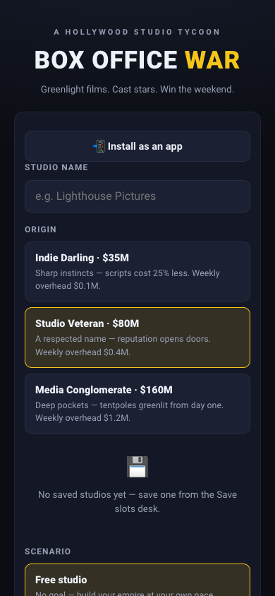
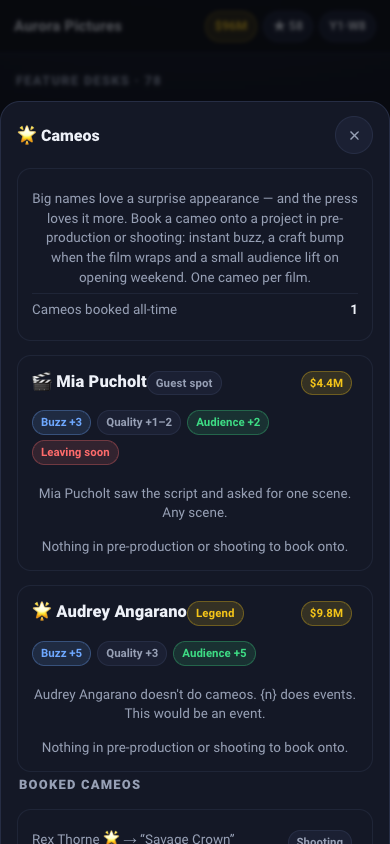
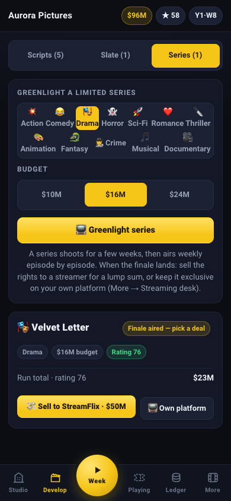
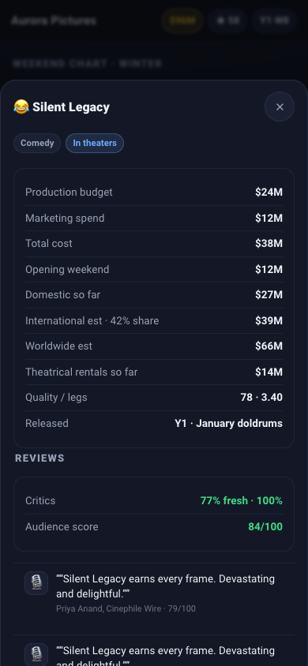
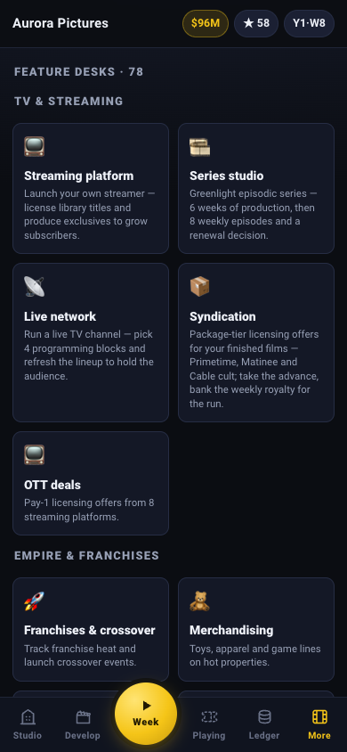

# Box Office War

> A phone-first Hollywood studio tycoon. Greenlight films, pitch your own projects,
> cast stars, book celebrity cameos, produce limited series for the streamers, pick
> your release dates and win the weekend — with 106 live feature desks running a
> deterministic weekly simulation.

[Download Android APK (latest)](https://github.com/pjneha66/Box-office-War/releases/latest) | [License: MIT](LICENSE)

---

## Screenshots

Captured from the v42.7 build (`node scripts/capture-readme-shots.mjs`).

| Start screen | Studio home | Cameos desk |
|---|---|---|
|  |  |  |

| Box office | Limited series | Release sheet |
|---|---|---|
|  |  |  |

| Feature desks (75+) | Pitch a project |
|---|---|
|  |  |

More screens — landscape layout, every feature desk, the greenlight sheet — can be
regenerated with `node scripts/capture-rebuild-screens.mjs` (writes 90+ shots to
`rebuild-notes/ss/`).

---

## What is new in v46.1 — the cashflow forecast tells the truth

Three defects, all masked by `typeof x === "function"` guards, so nothing ever threw:

- The 12-week cashflow projection was computed by a function in **ui.js**, which
  `engine.js` called. Headless runs had no forecast at all, and it only summed
  four of the eighteen modules that publish income hooks.
- `forecastAdjust_tv` was named by that aggregator but **defined nowhere** — so
  the streamer's subscription income and the syndication royalty tail, both real
  weekly earnings, never showed up in the projection.
- Fourteen modules had dead forecast hooks.

The engine now owns its own projection, sums every module, and `tv.js` reports
its real weekly numbers (including the upkeep deduction and the deal-expiry
cutoff). New guard: `test/no-phantom-hooks.mjs` proves all 126 guarded hooks the
engine references actually exist.

---

## What is new in v46.0 — the rival economy wakes up, eight new systems

**The rival studios were never real.** Every studio in the game tracked a
year-to-date gross of `0M` forever, because nothing in the code ever wrote that
field. That one dead value quietly broke three features the game already
advertised: the strongest/weakest rival actions always targeted the same studio,
the finance desk's comparable-company valuation showed `—` for everyone, and the
rival panel was a wall of zeros. Rival films were being simulated — real
openings, real decay — their gross simply never made it back to the studio that
released them. It does now.

That fix gives the career a scoreboard, and eight new systems build on it:

| System | What it adds |
|---|---|
| **Rival war room** | Industry ranking and market share. Rivals react to you winning — aggressive when they are losing, cowed when you have crushed them — and will poach your stars harder the more you dominate. Buy counter-programming against a named rival. |
| **Sequel planning** | Greenlight a sequel to a hit yourself instead of waiting for RNG. Each sequel in a franchise ships with decaying anticipation and craft, so a fourth entry is not a third printing of the first. |
| **Craft departments** | Cinematography, production design, sound mix and pre-viz heads. Assign them to a project and they move its craft, audience score, legs and reviews. |
| **Talent mentoring** | Pair a veteran with a young performer for 26 weeks. The mentee gains permanent skill, signs cheaper afterwards, and lifts the room when they finally headline. |
| **Studio legacy tiers** | Indie label → boutique → mid-tier → major → studio system → legacy house. Higher tiers open bigger films, borrow cheaper and sign talent on better terms. |
| **Distribution windows** | A real decision, in dollars: 90-day theatrical exclusive, 45-day standard, 17-day day-and-date or PVOD-first. A long hold sells more tickets and a shorter one sells a bigger streaming cheque. |
| **Guild relations** | Writers, actors, directors and crew, each with a mood, a contract expiry and a cost. Concede wages, offer residuals or back-end, or refuse and risk a strike. |
| **Deeper awards night** | Six below-the-line categories — cinematography, production design, sound, editing, score, ensemble — where a rival film can and will beat you. |

**Achievements now scale.** The trophy table used to be a closed list, so new
content shipped with no acknowledgement. Modules can now publish their own
trophies; the count went from 39 to 87, and every new system has its own.

### Bugs fixed

- The audience-analytics desk printed the literal word `undefined` where each
  film's genre belonged.
- Year-end awards returned early whenever the awards-night decision fired, so
  the below-the-line categories never ran for an entire career.
- The craft ceremony had no idempotency guard: a replayed season paid its
  bonuses twice ($8.9M duplicated).
- A hook was referenced from the opening calculation before the module that
  defines it existed.

### New shipping guards

- `test/wiring-integration.mjs` puts a call-spy on every engine hook and fails
  if the engine never reaches one — the only test that catches *"module
  written, hook never wired"*, which is the failure that shipped the legacy
  game in v44.0. It also renders all 106 desks and rejects `NaN`/`undefined`.
- `test/achievements-merge.mjs` proves module trophies reach the gallery and
  survive a stripped old save.
- `test/awards-payout-guard.mjs` proves a season pays its craft awards once.

---

## What shipped in v45.0 — release fix + four systems

**The v44.0 APK shipped the wrong game.** The release pipeline built the legacy
60-script game instead of the rebuilt one; v45.0 fixes the pipeline and ships
the rebuild, with a CI guard so it cannot happen again. If you installed v44.0
you were playing the old UI — v45.0 is the real rebuild.

**Four new systems, each a self-contained module:**

• **Studio operations** — product placement (4 sponsor tiers, paid up front
  against a critic penalty at release) and physical media pressing; C-suite
  officers whose perks are real multipliers (CFO −12% production cost, COO −15%
  overhead, CMO +20% brand advances, casting −10% fees +25% sell-through), with
  payroll actually deducted every week.
• **Live ops** — blind-box talent scouting with published odds (70/22/7/1) and
  dual pity rails, four studio amenities with real numeric effects, co-production
  pacts that advance cash for a gross share, and seasonal events whose challenge
  progress is credited from real releases (the legacy version never incremented
  progress, so it could never complete — fixed).
• **Marketing blitz** — a five-rung ladder from a $1.5M press junket to $36M
  global saturation, with campaign windows that decay if a release slips and a
  saturating diminishing-returns curve so stacking is not free money.
• **Console & hardware** — licence your games onto three platforms (Kinetix,
  PocketLynx, OpenDeck) and run a three-stage first-party console programme with
  live failure and overrun rolls, then collect hardware royalties weekly.

Also in this release: the **bundle-integrity guard** that caught `help.js` and
`boc-premium.css` being referenced but never packaged (the APK would have booted
with 404s), and flaky-test fixes that assert the mechanism rather than an RNG
outcome.

Ships as signed Android APK v45.0 (versionCode 58), installs over v43.2 and
v44.0 without losing saves — verified: both builds carry the same signing
certificate (SHA-256 `E0:9E:7C:E9:…:AC:2D`).
[Download v45.0 APK](https://github.com/pjneha66/Box-office-War/releases/download/v45.0/BoxOfficeWar-45.0.apk) | [v45.0 release](https://github.com/pjneha66/Box-office-War/releases/tag/v45.0)

---

## What was new in v43.2 — New UI (Rebuild) + Collection Command

Ships the modern rebuilt UI from `game/` with the **Box Office Collection Command** desk:

• Portrait-first design with CSS variables and inline SVG icon sprite
• Studio / Develop / Now playing / **Collection** / Ledger / More tabs
• Bottom week advance button, modal sheets, toast notifications
• Offline-capable, fully bundled in the APK

**Collection Command** (Box Office → Collection tab):
• **Screen Expansion Push** — buy more prints/shows on a live run (+12–26% weekly gross per level)
• **Event Pricing** — premium surcharge on PLF/IMAX/holiday weeks (+8–20% weekly gross per level)
• **International Blitz** — day-and-date dubs and press in cold territories (+10–22% weekly gross per level)
• **Merch & Tie-In Window** — character licensing while the picture is hot (converts heat to merch revenue)
• **Re-Release / Restoration Run** — anniversary prints for a closed title (+55–70% on the re-open)
• **Circuit Screens** — career asset that lifts every wide release (+2.2% per owned tranche)
• **Booking Corridor** — lock a clear weekend for your slate (+5% to every live run)
• **Discount Tuesday** — circuit-wide price program (+8% admissions)

All levers cost cash, run on week timers, and pay back through the normal ledger. A **global valve ceiling** keeps late-run income sane — growth is earned, not free.

Measured result: a fully pushed tentpole lifts its worldwide run **2–3× over baseline**, with every dollar traced to a lever in the coffer ledger. Existing saves load unchanged — all new state is optional and lazy-initialised.

Shipped as signed Android APK v43.2 (versionCode 55) — superseded by v45.0.

---

## What is new in v43.1 — New UI (Rebuild)

**Box Office Collection Command** — a new desk on the Box Office tab with player-driven levers that raise what each picture actually collects:

- **Screen Expansion Push** — buy more prints/shows on a live run (+12–26% weekly gross per level)
- **Event Pricing** — premium surcharge on PLF/IMAX/holiday weeks (+8–20% weekly gross per level)
- **International Blitz** — day-and-date dubs and press in cold territories (+10–22% weekly gross per level)
- **Merch & Tie-In Window** — character licensing while the picture is hot (converts heat to merch revenue)
- **Re-Release / Restoration Run** — anniversary prints for a closed title (+55–70% on the re-open)
- **Circuit Screens** — career asset that lifts every wide release (+2.2% per owned tranche)
- **Booking Corridor** — lock a clear weekend for your slate (+5% to every live run)
- **Discount Tuesday** — circuit-wide price program (+8% admissions)

All levers cost cash, run on week timers, and pay back through the normal ledger. A **global valve ceiling** keeps late-run income sane — growth is earned, not free.

Measured result: a fully pushed tentpole lifts its worldwide run **2–3× over baseline**, with every dollar traced to a lever in the coffer ledger. Existing saves load unchanged — all new state is optional and lazy-initialised.

Ships as signed Android APK v43.0 (versionCode 53), installs over previous builds without losing saves.
[Download v43.0 APK](https://github.com/pjneha66/Box-office-War/releases/download/v43.0/BoxOfficeWar-43.0.apk) | [v43.0 release](https://github.com/pjneha66/Box-office-War/releases/tag/v43.0)

## What is new in v42.7

- **Celebrity cameo system** — a rotating cameo market on the new 🌟 *Cameos* desk
  (More → Talent). Book a big name (or a ★5 legend, at legend money) onto any project
  in pre-production or shooting: instant buzz, a craft bonus when the film wraps, a
  small audience lift on opening weekend, and free press while they are on your lot.
  One cameo per film.
- **Full wiring of the wave-6/7 systems** (landed in v42.5/42.6): crew hiring
  (DP/editor/composer with craft bonuses, salary and soundtrack royalties), genre
  mastery with a "Known for" line on the Studio page, talent agencies (reputation,
  cheaper stars, first-look deals, hidden-gem scouting trips), production choices
  (rush / extended takes / reshoots), international offices (London · Tokyo · Seoul —
  international share, reputation growth and a local-language script pipeline), library
  licensing, the expanded year-end awards (Best Actor / Best Director / Best Original
  Song with FYC tie-ins), second-unit location shoots with weather risk, rival
  storylines (feuds, alliances, hostile takeovers), multi-week star scandal sagas, the
  festival circuit board, the studio museum, social virality and the sports megadome.

## What is new in v42.6

- **Series, end to end** — a *Series* tab in Develop: greenlight limited series,
  watch them air episode by episode, then **sell the rights to a streamer** for a
  lump sum or keep them exclusive on your own platform.
- **Pitch a project** — skip the scouts: develop a bespoke concept ($2M) with your
  own genre, theme and working title, straight onto the scripts desk.
- **Box office upgrade** — budget, marketing, total cost, domestic, international
  (with share estimate), **worldwide (estimated while running, final after)**, ROI %
  and a week-labeled weekly-gross chart on every film.
- **All casts from the previous build** — 958 first names / 1,238 surnames (was
  30/30), 121 talent abilities including species traits, plus animal-star signings
  in the Sandbox desk.
- **Deeper studio systems wired in** — 8 modules that shipped dead code are now live
  in the weekly tick and the More grid (78 desks).

---

## Overview

Box Office War runs an entire studio on a deterministic weekly tick — one global
state object, autosaved to local storage after every week, zero dependencies:

- **Development desk** — buy or pitch scripts, package director + lead (agency
  discounts, multi-picture deals), pick scale and budget, marketing tiers.
- **Production** — phases with overruns, location shoots and rebates, crew hiring,
  production choices, test screenings, recuts and clearance.
- **Release calendar** — 8 weeks of clash forecasting against announced rival
  slates, seasonal corridors (summer, holiday, horror), theatrical windows that
  exhibitors and streamers actually react to.
- **Box office war** — geometric weekend decay driven by quality, legs, word of
  mouth, marketing and clash severity; rivals counter-program your tentpoles.
- **Aftermarket** — international pre-sales, streaming & PVOD, library royalties,
  syndication, licensing, merchandise, theme parks, sports megadome.
- **The world** — rival AI with counter-programming, rival storylines, scandal
  sagas, festivals, award seasons with FYC campaigns, crisis years, guild strikes,
  piracy waves, espionage.
- **Empire** — in-house talent agency, studio lots and facilities, imprints,
  boards and credit ratings, bonds, mezzanine debt, stock price, dynasty
  succession (retire and inherit as your heir).

## Build & packaging

```bash
# rebuild the mobile web bundle (game/ → apk/www/)
node apk/build-www.js --rebuild

# package a signed APK: swaps assets/www/ into the APK shell, patches the binary
# AndroidManifest (versionCode / versionName) AXML-aware, then jarsigner signs it
python3 apk/tools/patch_axml.py apk/dist/<base>.apk apk/dist/out-unsigned.apk apk/www 53 42.7
jarsigner -keystore apk/signing/boxofficewar.keystore -storepass B0xOfficeWar2026 \
  -keypass B0xOfficeWar2026 -signedjar apk/dist/out.apk apk/dist/out-unsigned.apk bow
```

The game itself is plain ES5-style JavaScript with string-template UI and event
delegation — it runs from any static file server, installs as a PWA, and the APK
ships the same bundle (service worker stripped).

## Screenshots & development tooling

- `node scripts/capture-readme-shots.mjs` — README screenshots (this file)
- `node scripts/capture-rebuild-screens.mjs` — full gallery: every view and all
  78 feature desks, portrait + landscape (`rebuild-notes/ss/`)
- `node scripts/capture-store-screenshots.cjs` — legacy v41 store art

## License

[MIT](LICENSE)
