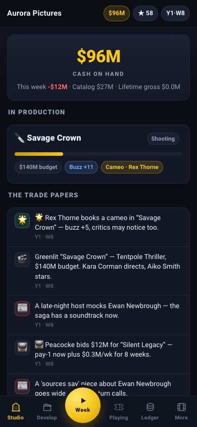
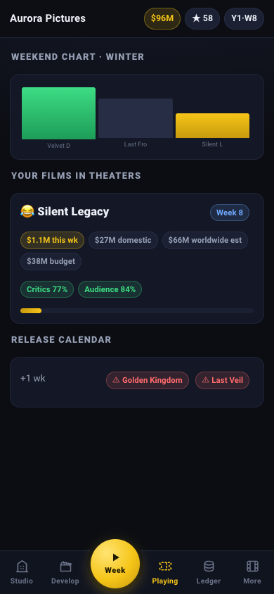

# Box Office War

> A phone-first Hollywood studio tycoon. Greenlight films, pitch your own projects,
> cast stars, book celebrity cameos, produce limited series for the streamers, pick
> your release dates and win the weekend — with 75+ live feature desks running a
> deterministic weekly simulation.

[Download Android APK (latest)](https://github.com/pjneha66/Box-office-War/releases/latest) | [License: MIT](LICENSE)

---

## Screenshots

Captured from the v42.7 build (`node scripts/capture-readme-shots.mjs`).

| Start screen | Studio home | Cameos desk |
|---|---|---|
|  |  |  |

| Box office | Limited series | Release sheet |
|---|---|---|
|  |  |  |

| Feature desks (75+) | Pitch a project |
|---|---|
|  |  |

More screens — landscape layout, every feature desk, the greenlight sheet — can be
regenerated with `node scripts/capture-rebuild-screens.mjs` (writes 90+ shots to
`rebuild-notes/ss/`).

---

## What is new in v43.0 — Box Office Collection Command

**Box Office Collection Command** — a new desk on the Box Office tab with player-driven levers that raise what each picture actually collects:

- **Screen Expansion Push** — buy more prints/shows on a live run (+12–26% weekly gross per level)
- **Event Pricing** — premium surcharge on PLF/IMAX/holiday weeks (+8–20% weekly gross per level)
- **International Blitz** — day-and-date dubs and press in cold territories (+10–22% weekly gross per level)
- **Merch & Tie-In Window** — character licensing while the picture is hot (converts heat to merch revenue)
- **Re-Release / Restoration Run** — anniversary prints for a closed title (+55–70% on the re-open)
- **Circuit Screens** — career asset that lifts every wide release (+2.2% per owned tranche)
- **Booking Corridor** — lock a clear weekend for your slate (+5% to every live run)
- **Discount Tuesday** — circuit-wide price program (+8% admissions)

All levers cost cash, run on week timers, and pay back through the normal ledger. A **global valve ceiling** keeps late-run income sane — growth is earned, not free.

Measured result: a fully pushed tentpole lifts its worldwide run **2–3× over baseline**, with every dollar traced to a lever in the coffer ledger. Existing saves load unchanged — all new state is optional and lazy-initialised.

Ships as signed Android APK v43.0 (versionCode 53), installs over previous builds without losing saves.
[Download v43.0 APK](https://github.com/pjneha66/Box-office-War/releases/download/v43.0/BoxOfficeWar-43.0.apk) | [v43.0 release](https://github.com/pjneha66/Box-office-War/releases/tag/v43.0)

## What is new in v42.7

- **Celebrity cameo system** — a rotating cameo market on the new 🌟 *Cameos* desk
  (More → Talent). Book a big name (or a ★5 legend, at legend money) onto any project
  in pre-production or shooting: instant buzz, a craft bonus when the film wraps, a
  small audience lift on opening weekend, and free press while they are on your lot.
  One cameo per film.
- **Full wiring of the wave-6/7 systems** (landed in v42.5/42.6): crew hiring
  (DP/editor/composer with craft bonuses, salary and soundtrack royalties), genre
  mastery with a "Known for" line on the Studio page, talent agencies (reputation,
  cheaper stars, first-look deals, hidden-gem scouting trips), production choices
  (rush / extended takes / reshoots), international offices (London · Tokyo · Seoul —
  international share, reputation growth and a local-language script pipeline), library
  licensing, the expanded year-end awards (Best Actor / Best Director / Best Original
  Song with FYC tie-ins), second-unit location shoots with weather risk, rival
  storylines (feuds, alliances, hostile takeovers), multi-week star scandal sagas, the
  festival circuit board, the studio museum, social virality and the sports megadome.

## What is new in v42.6

- **Series, end to end** — a *Series* tab in Develop: greenlight limited series,
  watch them air episode by episode, then **sell the rights to a streamer** for a
  lump sum or keep them exclusive on your own platform.
- **Pitch a project** — skip the scouts: develop a bespoke concept ($2M) with your
  own genre, theme and working title, straight onto the scripts desk.
- **Box office upgrade** — budget, marketing, total cost, domestic, international
  (with share estimate), **worldwide (estimated while running, final after)**, ROI %
  and a week-labeled weekly-gross chart on every film.
- **All casts from the previous build** — 958 first names / 1,238 surnames (was
  30/30), 121 talent abilities including species traits, plus animal-star signings
  in the Sandbox desk.
- **Deeper studio systems wired in** — 8 modules that shipped dead code are now live
  in the weekly tick and the More grid (78 desks).

---

## Overview

Box Office War runs an entire studio on a deterministic weekly tick — one global
state object, autosaved to local storage after every week, zero dependencies:

- **Development desk** — buy or pitch scripts, package director + lead (agency
  discounts, multi-picture deals), pick scale and budget, marketing tiers.
- **Production** — phases with overruns, location shoots and rebates, crew hiring,
  production choices, test screenings, recuts and clearance.
- **Release calendar** — 8 weeks of clash forecasting against announced rival
  slates, seasonal corridors (summer, holiday, horror), theatrical windows that
  exhibitors and streamers actually react to.
- **Box office war** — geometric weekend decay driven by quality, legs, word of
  mouth, marketing and clash severity; rivals counter-program your tentpoles.
- **Aftermarket** — international pre-sales, streaming & PVOD, library royalties,
  syndication, licensing, merchandise, theme parks, sports megadome.
- **The world** — rival AI with counter-programming, rival storylines, scandal
  sagas, festivals, award seasons with FYC campaigns, crisis years, guild strikes,
  piracy waves, espionage.
- **Empire** — in-house talent agency, studio lots and facilities, imprints,
  boards and credit ratings, bonds, mezzanine debt, stock price, dynasty
  succession (retire and inherit as your heir).

## Build & packaging

```bash
# rebuild the mobile web bundle (game/ → apk/www/)
node apk/build-www.js --rebuild

# package a signed APK: swaps assets/www/ into the APK shell, patches the binary
# AndroidManifest (versionCode / versionName) AXML-aware, then jarsigner signs it
python3 apk/tools/patch_axml.py apk/dist/<base>.apk apk/dist/out-unsigned.apk apk/www 53 42.7
jarsigner -keystore apk/signing/boxofficewar.keystore -storepass B0xOfficeWar2026 \
  -keypass B0xOfficeWar2026 -signedjar apk/dist/out.apk apk/dist/out-unsigned.apk bow
```

The game itself is plain ES5-style JavaScript with string-template UI and event
delegation — it runs from any static file server, installs as a PWA, and the APK
ships the same bundle (service worker stripped).

## Screenshots & development tooling

- `node scripts/capture-readme-shots.mjs` — README screenshots (this file)
- `node scripts/capture-rebuild-screens.mjs` — full gallery: every view and all
  78 feature desks, portrait + landscape (`rebuild-notes/ss/`)
- `node scripts/capture-store-screenshots.cjs` — legacy v41 store art

## License

[MIT](LICENSE)
