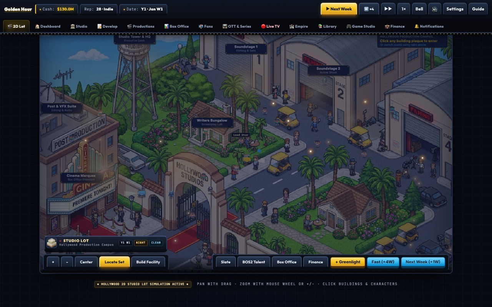
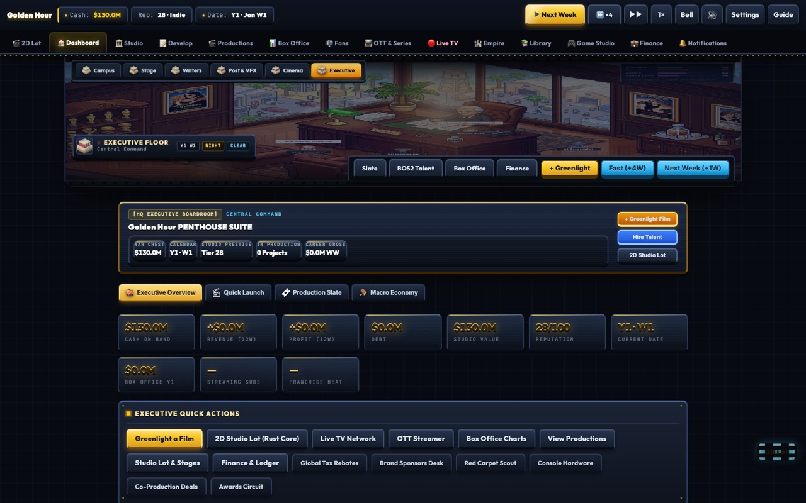
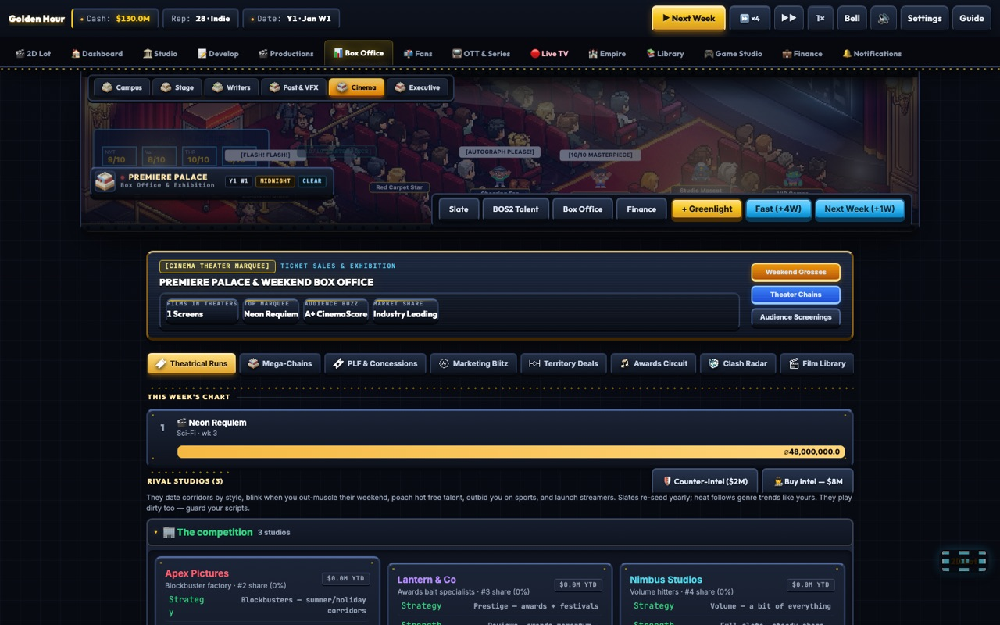
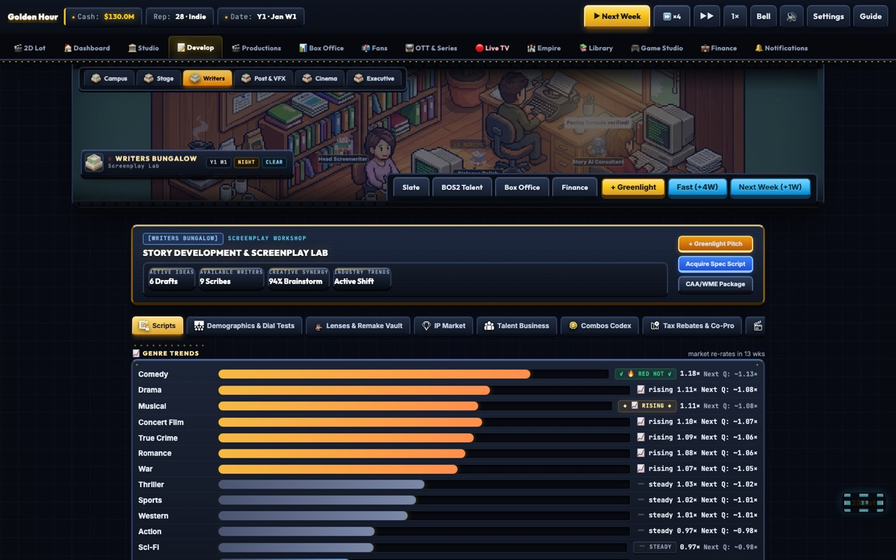
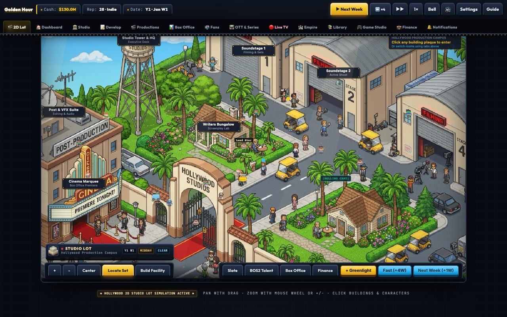
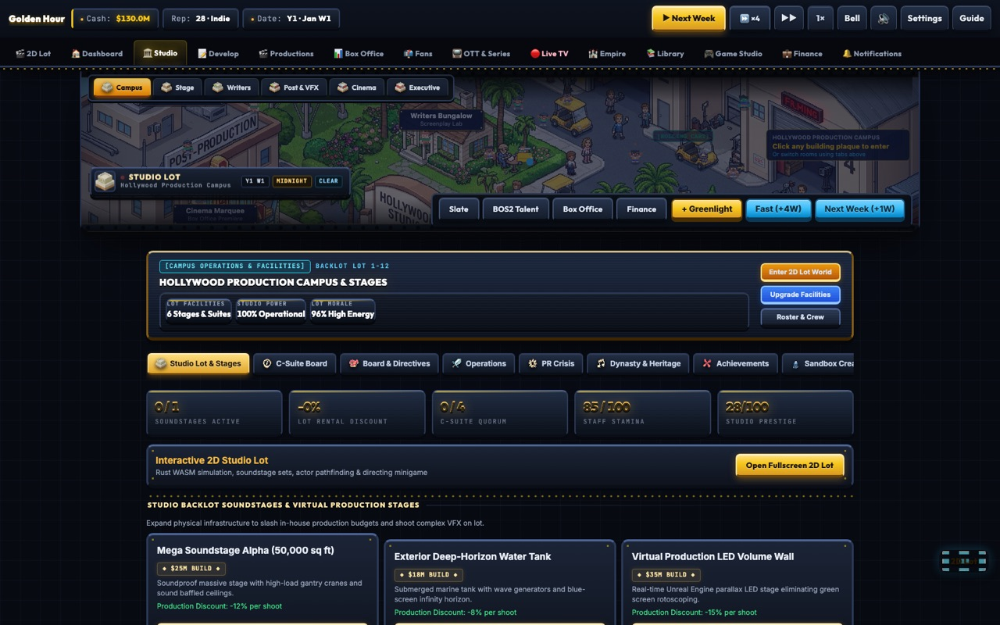

# Box Office War

> A deep Hollywood studio simulation and tycoon engine. Run a major film studio, navigate box office wars, build transmedia franchises, manage streaming platforms, and broadcast linear television networks.

[Play in Browser](https://box-office-war.vercel.app) | [Download Android APK v33.0](https://github.com/pjneha66/Box-office-War/releases/latest) | [License: MIT](LICENSE)

---

## Screenshots

| | |
|---|---|
|  |  |
| **2D Studio Lot — night lighting** | **Executive dashboard** |
|  |  |
| **Box office charts** | **Development pipeline** |
|  |  |
| **Studio lot by day** | **Studio operations** |

---

## Overview

Box Office War is an offline-capable Hollywood studio management simulation built entirely on client-side web standards. Players manage every dimension of an entertainment empire from a single production lot:
- Greenlight original screenplays and acquire high-profile intellectual properties.
- Package A-list actors, directors, writers, and producers through Hollywood talent agencies.
- Manage physical soundstages, virtual LED volumes, and audio post-production facilities.
- Navigate release calendar clashes, cannibalization risks, and seasonal holiday corridors.
- Monetize catalog libraries via theatrical runs, international territory pre-sales, linear TV syndication, consumer merchandise, and proprietary streaming services.
- Defend corporate standing against hostile board directives, corporate debt covenants, talent scandals, and rival studio espionage.

All simulation mechanics execute client-side with zero dependencies, zero microtransactions, and instant local storage persistence.

---

## What is New in v33.0

The v33.0 release is a full-app visual overhaul. Every screen is rebuilt on one locked design system ("Arcade Hollywood"), the studio lot became a living 24-hour world, and a motion engine animates every tab, sub-tab and chart.

### 1. Full-App Restyle (`bow-restyle.css`, 1,450 lines)
- **One locked visual system** applied to all 14 tabs, the start screen, modals, toasts, forms and the broadcast UI: 3px slate borders with a lit top edge, heavy dark bottom edge, and hard offset shadows with zero blur — the 16-bit tell.
- **Marquee chrome**: gold bulb strips on the topbar and section headers, gold corner studs on every panel, engraved card headers, filmstrip tab rail with a lit active frame.
- **Arcade scoreboard tiles** for KPI readouts, gold-framed modals with an overshoot pop-in, recessed inset inputs, chunky 3D buttons that press 3px down.
- **Safe-area insets** for notches and home bars, gold focus rings, pixel scrollbars, and full `prefers-reduced-motion` support.

### 2. Living Studio Lot (`lot-life.js`)
- **24-hour light cycle** — dawn, midday, golden hour, dusk and night, each with its own colour grade, plus per-room warm light pools (marquee bulbs, windows, street lamps, monitor glow) that switch on after dark.
- **Per-week weather** derived from the game week and season: clear, rain, storm with lightning, snow, and autumn leaves.
- **Ambient life**: drifting dust motes, birds crossing the sky, fireflies at night, camera flashes on the red carpet, volumetric light shafts, film grain and a cinematic vignette.
- **Location card** and an iris wipe on every room change.

### 3. Animated Cast (`studio-lot-2d.js`)
- **Real walk cycles** — bob, lean and squash driven off a single phase, so bodies weight-shift instead of sliding.
- **Pause-and-turn** at path ends with idle breathing, eased facing, and depth sorting so nearer walkers overlap correctly.
- **Footstep dust**, role pips, and one speaker at a time for chatter.
- **21 cast members** (up from 12) with distinct roles, speeds and routes.
- **Golf carts** with visibly spinning wheels and spokes, a driver that bobs with the suspension, tyre dust, and a headlight cone that switches on at night.

### 4. Motion Engine (`bow-motion.js`)
- **Staggered entrance** on every panel in every tab and sub-tab, with ledger rows cascading in.
- **Count-up** on every numeric readout, keyed off a stable label so a freshly re-rendered DOM still ticks from the previous value, with a **green pulse on rise and red on fall**.
- **Charts animate**: box office bars grow from zero and cascade, weekly-gross and forecast bars rise, stock sparklines and donuts draw themselves in via stroke-dashoffset.
- **Game-feel layer** (`lot-feel.js`): trauma-based screen shake (`trauma²` sampled from layered sines so it decays smoothly instead of buzzing), squash-and-stretch pops, and tiered feedback hooked into the game's own `toast` / `confetti` / `advanceWeek` events — by decoration, never by modification.

### 5. Build & Repo Fixes
- **`apk/build-www.js` was silently shipping a stale UI**: its hardcoded file list was missing `ui-v33.css` entirely, plus every new presentation layer. Any new root-level `.css`/`.js` must be added to that list or the APK will not change. All five layers now ship.
- **Git repair**: 17,259 macOS AppleDouble `._*` sidecars had accumulated untracked, and two were being read as pack indexes, which corrupted the repository ("non-monotonic index"). They are now backed up, removed from `.git`, and ignored. `core.fileMode` was disabled to stop 602 permission-only diffs.

---

## What is New in v32.13

The v32.13 release delivers a major 2D visual and mechanical overhaul, synthesizing deep simulation features from benchmark reference titles (Kairosoft Game Dev Story, Social Dev Story, Idle Sports Stadium Tycoon, and Box Office Sim 2) alongside persistent 2D simulation staging and landscape orientation locking:

### 1. 2D Kairosoft Studio Rooms & Simulation Lot (`studio-lot-2d.js`, `kairo-theme-suite.js`)
- **6 Interactive Studio Departments**: Campus Grounds, Soundstage A, Writers' Bungalow, Post & VFX Suite, Cinema Marquee, and Executive Penthouse.
- **Dynamic 16-Bit Scene Visuals**: High-contrast, handcrafted pixel art scenes with animated department headers, pixel marquee bulbs, and CRT scanlines.
- **Micro-Animated Department Workers**: Desk writers, boom mic operators, video editors, preview screening audiences, and penthouse studio executives animated in real time.
- **Seamless Stage Switcher**: Live navigation header with direct department shortcuts, room stats badges, and simulation HUD.

### 2. Box Office Sim 2 Cast Integration (`box-office-sim-2-cast.js`)
- **Extracted Reference Roster**: 72 unique character species, 121 specialized talent abilities, and over 4,000 real-world actor, director, writer, and producer names extracted directly from Box Office Sim 2 APK data.
- **Dynamic Ability Tagging**: In-depth talent quirks including Box Office Anchor, Method Legend, Franchise Magnet, Festival Darling, and Critical Shield.
- **Backward-Compatible Talent Mapping**: Integer ID translation layer ensuring seamless integration with existing save games and casting pipelines.

### 3. GameStudio GDD Engine (`gamestudio-gdd-engine.js`)
- **Game Dev Story & Tycoon Mechanics**: Complete Game Design Document (GDD) production cycle with Topic x Genre synergy matching (e.g., Cyberpunk RPG, Fantasy Strategy, Superhero Action).
- **Target Audience Weighting**: Age-demographic balancing across Young, Teen, and Mature gaming markets.
- **Proprietary Engine Builder**: Design custom 2D/3D game engines with custom technology and design allocations.
- **Gaming Press Reviews & GameCon**: 4 simulated gaming review publications (PixelPolygon, HyperJoy, BitCollider, EdgeOfPlay) with dynamic quotes, GameCon booth marketing, and Research Points economy.

### 4. Social Viral Network (`social-viral-network.js`)
- **Social Dev Story Mechanics**: 4 active digital platforms (InstaBuzz, VidTok, ChirpNet, StreamTube) featuring algorithmic trend velocity, hashtag momentum, and organic audience reach.
- **Viral Marketing Campaigns**: 6 campaign tiers from Grassroots Leak and Meme Blitz to Influencer Premiere Screenings and Global Trend Takeovers.
- **Creator Ambassador Deals**: Contract digital creators for multi-week studio endorsement pacts that amplify film buzz and OTT subscriber acquisition.

### 5. Sports Stadium Megadome Deals (`sports-stadium-deals.js`)
- **Idle Sports Tycoon Mechanics**: Expand and operate a state-of-the-art sports arena (Seating Capacity, VIP Luxury Skyboxes, Concessions Court, and Broadcast Jumbotrons).
- **Corporate Naming Rights**: High-value annual naming rights agreements with Fortune 500 corporate partners (Apex Energy, Horizon Tech, Zenith Capital).
- **Exclusive Live Sports Broadcast Packages**: License tier-one live sporting events (Sunday Football, Championship Basketball, Grand Slam Tennis, Sunset Grand Prix, Apex Esports) for studio streaming services.

### 6. Landscape Orientation Lock & Offline Android APK
- **Android Manifest Lock**: Native Capacitor Android configuration locked to `sensorLandscape` mode.
- **Complete Offline Bundle**: 55 modular engines, sound suites, and pixel art assets packed directly into the APK distribution without requiring internet connectivity or external servers.

---

## Simulation Architecture: 33 Modular Systems

Box Office War is structured into 33 decoupled simulation modules operating on an event-driven weekly tick loop:

| Module File | Simulation System | Core Mechanics |
|---|---|---|
| `engine.js` | Core Simulation Loop | 52-week calendar, weekly financial clearing, talent availability, box office decay, rival studio AI turns. |
| `data.js` | Industry Data & Balance | Talent pool (actors, directors, writers, producers), genres, archetypes, themes, awards, and historical milestones. |
| `ui.js` | Executive Interface | Responsive dashboard, wizard modals, tabs navigation, glassmorphic HUD chips, keyboard shortcuts (Cmd+K). |
| `studio-facilities.js` | Studio Lot & Soundstages | 4 facility tiers (Soundstage Complex, LED Volume, Atmos Mixing, Historic Lot), quality buffs, rival lot rental income. |
| `syndication-tv.js` | Television Syndication | Linear broadcast monetization (Primetime 26w, Matinee 39w, Cable 52w), catalog rights, advance fees. |
| `talent-contracts.js` | Multi-Picture Deals & Quirks | 3-picture and 5-picture talent retention pacts, 6 psychological quirks (`method_actor`, `crowd_puller`, `award_magnet`). |
| `bond-market.js` | Corporate Debt & Bonds | AAA to CCC corporate credit rating engine, 52-week securitized debt issuance, weekly interest service. |
| `clash-analytics.js` | Release Clash Radar | Opening weekend cannibalization analysis, audience overlap calculations, counter-programming bonuses. |
| `cinematic-universe.js` | Shared Cinematic Universes | Multi-franchise IP bibles, crossover event multipliers (+65% buzz), lore consistency tracking, fatigue control. |
| `location-scouting.js` | International Production Hubs | Global production locations (London, Atlanta, Iceland, Tokyo, New Zealand) providing tax rebates and quality bonuses. |
| `production-insurance.js` | Completion Bonds | Risk mitigation policies (Overrun Shield, Key Cast Indemnity, Full Completion Bond) against budget spikes. |
| `awards-campaign.js` | FYC Lobbying Campaign | For Your Consideration trade advertising, screener mailings, voter receptions, and guild momentum tracking. |
| `board-targets.js` | Board of Directors Mandates | Quarterly board directives, studio confidence index (0-100%), executive bonuses, and austerity budget caps. |
| `fan-conventions.js` | Convention Fan Showcases | Comic-Con Hall H and Worldwide D23 presentations, studio fan club membership tiers, opening buzz spikes. |
| `test-screenings.js` | Test Screenings & Reshoots | Focus group audience cards, pacing ratings, tracking legs estimation, and post-production emergency reshoots. |
| `studio-espionage.js` | Covert Intelligence Desk | Clandestine surveillance, rival slate infiltration, talent contract expiration theft, counter-PR media leaks. |
| `merch-licensing.js` | Franchise Merchandising | Product lines (Toys, AAA Video Games, Apparel, Theme Parks), upfront licensee advances, weekly royalties. |
| `territory-licensing.js` | Foreign Pre-Sales Desk | International territory distribution deals, minimum guarantees, regional box office royalty sharing. |
| `custom-sandbox.js` | Sandbox & Holiday Engine | Custom studio, talent, and rival creator tools, 52-week holiday corridors, custom release calendars. |
| `v31-features.js` | Crisis PR & Agency Packaging | Crisis PR containment desk (4 response protocols), elite agency packaging (CAA/WME/UTA) with packaged discounts. |
| `finance-tools.js` | Corporate Finance Suite | Detailed weekly P&L ledgers, 12-week cashflow forecasting, mezzanine debt facilities, and CSV financial exports. |
| `challenge-leaderboard.js` | Seeded Challenge Engine | Deterministic weekly scenario seeds, standardized challenge scoring, and shareable studio performance codes. |
| `theater-chains.js` | Theatrical Exhibition Networks | Independent exhibitor relations, premium format splits (IMAX, Dolby Cinema), and concession revenue sharing. |
| `dynamic-soundtrack.js` | Adaptive Audio Atmosphere | Synthesized Web Audio soundtrack that responds dynamically to studio cash solvency, box office hits, and crises. |
| `dynasty-legacy.js` | Multi-Generational Legacy | Post-retirement dynasty bonuses, family trust fund generation, heirloom studios, and generational succession. |
| `bow-shorts.js` | Short-Form Digital Media | Episodic streaming shorts, viral digital content, social platform monetization, and rising talent discovery. |
| `talent-agency.js` | In-House Agency Operation | Establish a proprietary studio talent agency, manage client rosters, collect commission fees, and train stars. |
| `studio-lot-2d.js` | 2D Kairosoft Studio Rooms | 6 interactive 16-bit studio departments with animated workers, live status synchronization, and responsive room switcher. |
| `kairo-theme-suite.js` | 16-Bit Theme & Scene Art | Retro pixel art styling, department header micro-animations, CRT scanlines, and animated marquee bulb borders. |
| `box-office-sim-2-cast.js` | BOS2 Talent & Ability Matrix | 72 species, 121 character abilities, and 4,000+ talent names extracted from Box Office Sim 2 reference data. |
| `gamestudio-gdd-engine.js` | GameStudio GDD Engine | Topic x Genre synergy matrix, target audience weighting, custom engine builder, 4 gaming reviews, and GameCon booths. |
| `social-viral-network.js` | Social Viral Network | 4 digital social platforms, algorithmic trend velocity, 6 viral campaigns, and creator ambassador endorsement deals. |
| `sports-stadium-deals.js` | Sports Stadium Megadome | Stadium tier upgrades, corporate naming rights, and exclusive live sports streaming broadcast rights packages. |

---

## Reference Parity Breakdown

Box Office War synthesizes gameplay systems from classic business simulations into a coherent, modern framework:

### Game Dev Story & Tycoon Parity
- **GDD Formulation**: Topic x Genre synergy mechanics with target audience demographics (Everyone, Teens, Mature).
- **Custom Game Engine R&D**: Allocate technology, design, and graphics resources to build proprietary game engines.
- **Gaming Press Reviews & GameCon**: 4 simulated publications (PixelPolygon, HyperJoy, BitCollider, EdgeOfPlay) and annual GameCon booths.

### Social Dev Story Parity
- **Multi-Platform Social Ecosystem**: InstaBuzz, VidTok, ChirpNet, and StreamTube with real-time algorithm velocity and hashtag trends.
- **Viral Marketing Campaigns**: 6 campaign tiers from Grassroots Leak and Meme Blitz to Global Trend Takeovers.
- **Creator Ambassador Network**: Retain digital influencers to amplify theatrical opening buzz and streaming subscriber influx.

### Idle Sports Stadium Tycoon Parity
- **Megadome Facilities**: Upgrades to Seating Capacity, VIP Luxury Skyboxes, Concessions Court, and Broadcast Jumbotrons.
- **Corporate Naming Rights**: Multi-year commercial sponsorship contracts with Fortune 500 conglomerates.
- **Live Sports Streaming Packages**: License exclusive broadcasting rights for major sports leagues to drive OTT growth.

### Box Office Inc Parity
- **Hollywood Talent Agencies**: Tiered agency representation (CAA, WME, UTA) with packaged star bundles and volume commission structures.
- **International Pre-Sales**: Regional minimum guarantees (MG) that offset production exposure before principal photography wraps.
- **Crisis Media Spin**: Formal PR war room protocols to navigate talent scandals without scrapping multimillion-dollar productions.

### Box Office Sim 2 Parity
- **Extracted Cast Database**: Over 4,000 real-world actor, director, writer, and producer reference names with 72 species and 121 abilities.
- **Box Office Clash Radar**: Direct computation of screen cannibalization between competing releases sharing identical demographic quadrants.
- **Dynamic Decay Curves**: Realistic box office legs calculated from the spread between critical reviews and audience exit-poll word of mouth.
- **Windowing Tradeoffs**: Explicit choice between 17-day, 45-day, and 90-day theatrical windows with exhibitor relation consequences.

### Silver Screen Story Parity
- **Lot Infrastructure Development**: Permanent physical upgrades to production lots including soundstages, digital mixing suites, and backlots.
- **Theme and Genre Chemistry**: Hidden synergies between 266 genre and theme pairings discovered through production experience.
- **Talent Progression**: Directors and actors earn XP on every shoot, leveling up technical execution, charisma, and speed attributes.

### TV Studio Story Parity
- **24/7 Linear EPG Grid**: 24-hour programming grid scheduling across 8 television networks with format blocks and prime-time ad rates.
- **Broadcast Syndication**: Secondary broadcast rights monetization for catalog films past their primary theatrical and streaming cycles.

---

## Installation & Deployment

### Web Application (PWA)
Box Office War runs directly in any modern web browser without dependencies or build steps:
```bash
# Serve locally using any static web server
python3 -m http.server 8080
# Open http://localhost:8080 in Chrome, Safari, Firefox, or Edge
```

### Android APK (v32.3)
1. Download the latest signed release APK from [GitHub Releases](https://github.com/pjneha66/Box-office-War/releases/latest).
2. Install the APK on your Android device (Android 8.0 Oreo or higher supported).
3. The application operates 100% offline, caching all scripts, audio synthesis engines, and SVG assets locally.

### Building the Android APK from Source
Prerequisites: Node.js 18+, JDK 21, and Android SDK command-line tools.
```bash
# 1. Prepare web bundle into apk/www
node apk/build-www.js

# 2. Synchronize web assets with Capacitor Android
cd apk
npx cap sync android

# 3. Compile release APK with Gradle
cd android
./gradlew assembleRelease --no-daemon

# The signed release APK will be generated at:
# apk/android/app/build/outputs/apk/release/app-release.apk
```

---

## Test Suite & Verification

The project enforces automated test coverage across headless economic simulations, full UI state verification, and long-range scenario balance:

```bash
# Execute entire test suite
npm test

# Run individual test harnesses:
npm run test:engine     # Headless 5-year economy simulation (smoke.js)
npm run test:ui         # Full UI click-through & modal interactions (ui-test.mjs)
npm run test:balance    # Economy invariants across 6 seeds x 120 weeks (balance.js)
npm run test:scenarios  # Automated 200-week playthroughs for all 5 scenarios (scenario-playthrough.mjs)
npm run test:library    # Catalog and M&A bulk action validations (verify-library.mjs)
npm run validate:slots  # Save slot structural validation (validate-slots.js)
```

---

## Architecture & Design Principles

- **Zero Framework Overhead**: Written in standard, high-performance vanilla JavaScript (ES6+), semantic HTML5, and pure CSS custom properties (`design-tokens.css`).
- **Deterministic State Serialization**: All game state is encapsulated in a single global object `G`, validated via schema migrations (`migrateSave`), and serialized to browser `localStorage` and `IndexedDB`.
- **Keyboard Power Tools**: Built-in Command Palette (`Cmd+K` / `Ctrl+K`), arrow-key grid navigation, and comprehensive keyboard shortcuts for high-speed management.
- **Accessibility & Internationalization**: Screen-reader live regions (`role="status"`, `role="alert"`), system motion preference detection (`prefers-reduced-motion`), and full English / Hindi localization dictionaries.

---

## License

MIT License. Open source for modification, study, and distribution.
